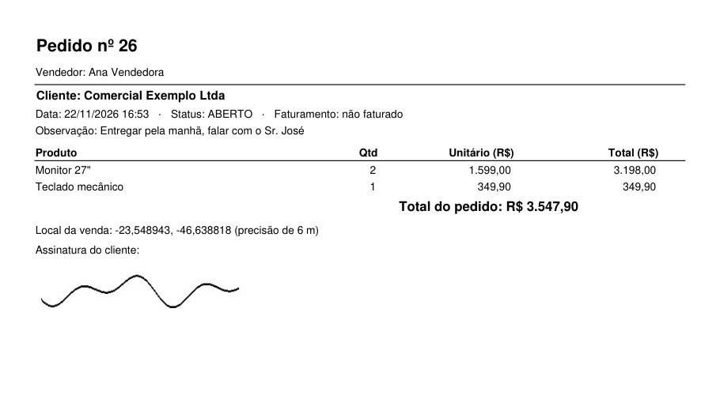
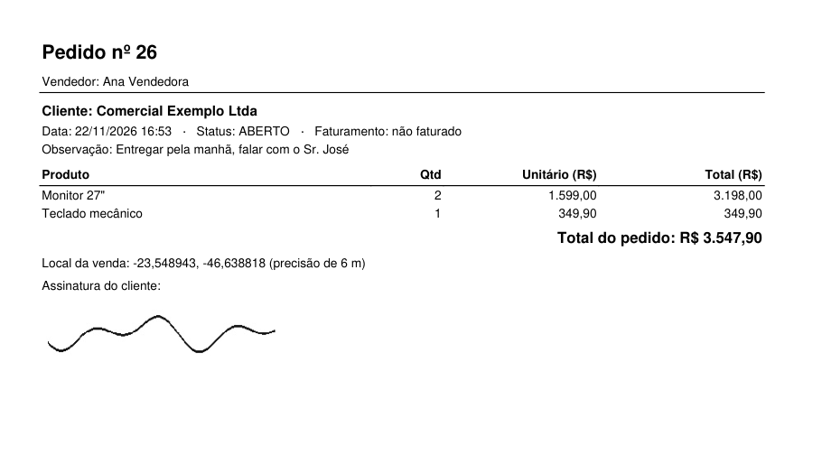
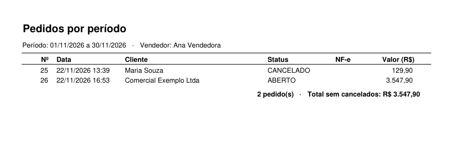
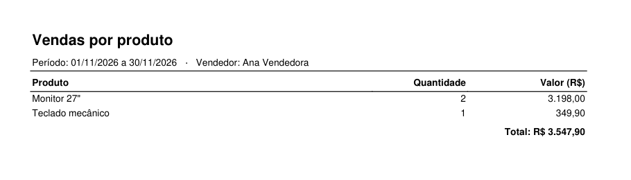

# delphi-horse-api

API REST desenvolvida em **Delphi** com o framework **[Horse](https://github.com/HashLoad/horse)** e banco de dados **Firebird**, com autenticação **JWT** e arquitetura em camadas.

> Faz parte do meu portfólio. É a base de um ecossistema:
> - o cliente desktop [delphi-vcl-client](https://github.com/kauelessa/delphi-vcl-client) (VCL + DevExpress) consome todos os endpoints desta API e cria os pedidos;
> - o [delphi-emissor-nfe](https://github.com/kauelessa/delphi-emissor-nfe) (ACBr) fatura esses pedidos como NF-e, lendo-os de `GET /pedidos` e `GET /clientes/:id`, e avisa a API quando a nota é autorizada ou cancelada;
> - o app de força de vendas [delphi-fmx-forca-vendas](https://github.com/kauelessa/delphi-fmx-forca-vendas) (FireMonkey, Windows e Android, em construção) tira pedidos na rua, até sem internet, e sincroniza com esta API.
>
> O ciclo completo: **pedido no app → gestão no cliente VCL → NF-e no emissor → o app mostra "Faturado na NF-e 123"**.

## 🎯 Objetivo

Demonstrar boas práticas no desenvolvimento back-end com Delphi:

- Endpoints REST com JSON (CRUD de clientes, produtos e pedidos)
- Autenticação e autorização com JWT
- Separação em camadas (Controller → Service → Repository)
- Acesso a dados com FireDAC + Firebird
- Testes unitários com DUnitX
- Tratamento padronizado de erros e validações
- Sincronização incremental para app offline (`?desde=`), envio idempotente por UUID e refresh token com rotação
- Relatórios em PDF gerados no servidor, com **Fortes Report** ou **FastReport** à escolha de quem pede

## 🧱 Tecnologias

| Item | Versão / Ferramenta |
|---|---|
| Linguagem | Delphi (Object Pascal) |
| Framework HTTP | Horse |
| Middlewares | jhonson (JSON), horse-cors, tratamento de erros próprio |
| JWT | delphi-jose-jwt (HS256) |
| Banco de dados | Firebird 5.0 |
| Acesso a dados | FireDAC |
| Gerenciador de pacotes | Boss |
| Relatórios | Fortes Report CE e FastReport VCL (opcional, diretiva `FASTREPORT`) |
| Testes | DUnitX |

## 📁 Estrutura

```
delphi-horse-api/
├── src/
│   ├── Controllers/   # Rotas e tratamento das requisições HTTP
│   ├── Services/      # Regras de negócio
│   ├── Repositories/  # Acesso ao banco (FireDAC)
│   ├── Models/        # Entidades e DTOs
│   └── Infra/         # Conexão, configuração, utilitários
├── database/          # Scripts SQL de criação do banco
├── tests/             # Testes unitários (DUnitX)
└── docs/
    ├── exemplos/      # Corpos de requisição JSON (válidos e inválidos)
    └── screenshots/   # Relatórios gerados
```

## ▶️ Como executar

1. Instale o [Firebird 5.0](https://firebirdsql.org/) (os scripts também funcionam no 3.0 e no 4.0). Banco e tabelas podem ser criados pela própria API na primeira execução (veja [Migrações](#migrações)); basta a pasta do arquivo `.fdb` existir no servidor.
2. Instale o [Boss](https://github.com/HashLoad/boss) e, na pasta do projeto (com o projeto **fechado** no RAD Studio), rode:
   ```
   boss install
   ```
   O Boss baixa as dependências em `modules/` e grava os caminhos no Search Path do `DelphiHorseApi.dproj`, que já vem versionado com esses caminhos.
3. Copie `config.example.ini` para `config.ini` (na pasta do executável) e preencha a conexão com o banco e o `Segredo` do JWT (mínimo de 32 caracteres). Em desenvolvimento, ligue `CriarBanco=1` e `ExecutarSeeds=1` na seção `[Migracao]` para subir com banco, tabelas e dados de exemplo prontos.
4. Instale o [Fortes Report CE](https://github.com/fortesinformatica/fortesreport-ce) pelo instalador dele (fica no Library Path do RAD Studio). O **FastReport VCL** é opcional e comercial: o projeto vem com a diretiva `FASTREPORT` ligada; sem o FastReport instalado, tire `FASTREPORT` de *Project > Options > Delphi Compiler > Conditional defines* (no app e nos testes). A API compila só com o Fortes e o motor `fastreport` responde `501`.
5. Abra `DelphiHorseApi.dproj` no RAD Studio, compile e execute.
6. A API sobe por padrão em `http://localhost:9000`, ouvindo em todas as interfaces. Para o app no celular, use o IP do PC na rede local (ex.: `http://192.168.0.10:9000`) e libere a porta 9000 no firewall do Windows.

Testes: abra `tests/DelphiHorseApiTests.dpr` (requer DUnitX, que já vem com o RAD Studio) e execute. Os testes rodam sem banco e sem a API no ar, mas usam o `delphi-jose-jwt` de `modules/` (rode o `boss install` antes) e geram PDFs de verdade com o Fortes (e com o FastReport, se a diretiva estiver ligada).

### Migrações

Ao subir, a API cria o banco se ele não existir (com `CriarBanco=1`) e aplica os scripts de `database/` que ainda não rodaram naquele banco, em ordem de nome, e registra cada um na tabela `SCHEMA_VERSAO`:

| Script | Conteúdo | Quando roda |
|---|---|---|
| `001_create_tables.sql` | usuários | sempre |
| `002_seed_usuario_admin.sql` | usuário `admin` / senha `admin123` | só com `ExecutarSeeds=1` |
| `003_create_tables_vendas.sql` | clientes, produtos e pedidos | sempre |
| `004_seed_dados_exemplo.sql` | clientes e produtos de exemplo | só com `ExecutarSeeds=1` |
| `005_forca_vendas.sql` | app Força de Vendas: código de barras, UUID, localização, foto, assinatura, faturamento, visitas, sessões e `ATUALIZADO_EM` | sempre |
| `006_seed_forca_vendas.sql` | vendedora `ana` / senha `ana123`, códigos de barras e coordenadas de exemplo | só com `ExecutarSeeds=1` |

Configuração na seção `[Migracao]` do `config.ini`:

| Chave | Padrão | Descrição |
|---|---|---|
| `CriarBanco` | `0` | cria o arquivo do banco (charset UTF8) se ele não existir. Desligue em produção: um caminho errado criaria um banco vazio em vez de dar erro |
| `Executar` | `1` | `0` desliga as migrações (o schema passa a ser responsabilidade de quem implanta) |
| `ExecutarSeeds` | `0` | aplica os scripts com `_seed_` no nome. **Use só em desenvolvimento** |
| `Pasta` | `database` | pasta dos scripts, absoluta ou relativa ao executável |

Regras: um script já aplicado nunca roda de novo, então mudanças no banco vão sempre em um **script novo** com o próximo número. Um seed pulado não é registrado; se `ExecutarSeeds` for ligado depois, ele roda na próxima subida. Se um script falhar, a API não sobe e mostra o erro.

#### Problemas comuns na instalação

**`F2613 Unit 'Horse' not found`**: o Search Path do projeto não aponta para `modules/`. Isso acontece quando o `boss install` roda antes de existir o `.dproj` ou com o projeto aberto (o RAD Studio sobrescreve o arquivo ao salvar). Feche o projeto, rode `boss install` de novo e reabra. Se continuar, adicione manualmente em *Project → Options → Building → Delphi Compiler → Search path* (alvo *All configurations – All platforms*):

```
modules\.dcp;modules\.dcu;modules\github_com_hashload_horse\src;modules\github_com_hashload_jhonson\src;modules\github_com_hashload_horse-cors\src;modules\github_com_hashload_handle-exception\src;modules\github_com_paolo-rossi_delphi-jose-jwt\Source;modules\github_com_paolo-rossi_delphi-jose-jwt\Source\Common;modules\github_com_paolo-rossi_delphi-jose-jwt\Source\JOSE
```

**`failed to load package ... hashlib4pascal\boss.json`**: o pacote `horse-jwt` depende do `hashlib4pascal`, que não tem `boss.json`. Isso interrompe o `boss install` inteiro. Este projeto valida o JWT com middleware próprio (`delphi-jose-jwt`) e não usa o `horse-jwt`, então não o adicione ao `boss.json`.

### Autenticação

Todas as rotas, exceto `/health` e `/auth/login`, exigem o cabeçalho `Authorization: Bearer <token>`.

```
curl -X POST http://localhost:9000/auth/login   -H "Content-Type: application/json"   -d '{"login": "admin", "senha": "admin123"}'
```

```json
{
  "token": "eyJhbGciOiJIUzI1NiIsInR5cCI6IkpXVCJ9...",
  "tipo": "Bearer",
  "expiraEm": "2026-11-19T22:30:00.000-03:00",
  "refreshToken": "q3Y0m2rV...",
  "refreshExpiraEm": "2026-12-19T21:30:00.000-03:00"
}
```

O `token` vale 60 minutos (`[JWT] ExpiracaoMinutos`). O `refreshToken` vale 30 dias (`[JWT] RefreshDias`) e serve para pegar um par novo sem pedir a senha de novo (é o que o app usa no login por biometria):

- `POST /auth/renovar` com `{ "refreshToken": "..." }` devolve um token e um refresh **novos**; o refresh enviado deixa de valer (rotação).
- Se um refresh já usado aparecer de novo, alguém guardou uma cópia dele: a API derruba a sessão inteira daquele login e pede usuário e senha.
- `POST /auth/sair` com `{ "refreshToken": "..." }` encerra a sessão (`204`).
- O banco guarda só o hash SHA-256 do refresh, nunca o valor.
- O `login` aceita um campo opcional `dispositivo` (ex.: `"Moto G - Android 14"`), gravado na sessão.

### Exemplo: criar um pedido

```
curl -X POST http://localhost:9000/pedidos   -H "Authorization: Bearer <token>"   -H "Content-Type: application/json"   -d '{"clienteId": 1, "itens": [{"produtoId": 1, "quantidade": 2}, {"produtoId": 2, "quantidade": 1}]}'
```

```json
{
  "id": 1,
  "cliente": { "id": 1, "nome": "Maria Souza" },
  "data": "2026-11-20T10:15:00.000-03:00",
  "status": "ABERTO",
  "valorTotal": 829.7,
  "itens": [
    { "id": 1, "produtoId": 1, "descricao": "Teclado mecânico", "quantidade": 2, "precoUnitario": 349.9, "valorTotal": 699.8 },
    { "id": 2, "produtoId": 2, "descricao": "Mouse sem fio", "quantidade": 1, "precoUnitario": 129.9, "valorTotal": 129.9 }
  ]
}
```

Outros corpos de requisição prontos (válidos e inválidos, para ver as respostas de erro) ficam em [`docs/exemplos/`](docs/exemplos/). Com curl, use `-d @docs/exemplos/pedido.json`.

### Listagens paginadas

`GET /clientes`, `/produtos` e `/pedidos` aceitam `?pagina=1&limite=20` (limite máximo 100) e respondem:

```json
{ "dados": [ ... ], "pagina": 1, "limite": 20, "total": 57 }
```

`GET /pedidos` também aceita `?clienteId=1`.

`GET /clientes` e `/produtos` aceitam `?busca=` (combinável com a paginação; o `total` passa a contar só o que foi encontrado):

- **Clientes**: procura o texto no nome, sem diferenciar maiúsculas, e no documento comparando só letras e números. `?busca=maria`, `?busca=529.982.247-25` e `?busca=52998224725` funcionam.
- **Produtos**: procura o texto na descrição, sem diferenciar maiúsculas.

O texto é tratado literalmente (`%` e `_` não são curingas) e vai para o SQL só como parâmetro. A comparação diferencia acentos: `mecânico` encontra "Teclado mecânico", `mecanico` não.

### App Força de Vendas: sincronização e envio offline

O app trabalha com um banco SQLite próprio e conversa com a API em lotes. Para isso:

- **Recebimento incremental:** `GET /clientes`, `/produtos`, `/pedidos` e `/visitas` aceitam `?desde=<data ISO 8601>` e devolvem só o que mudou desde então, **incluindo inativos e cancelados** (para o app saber o que sumiu), em ordem estável de alteração. Toda listagem responde também `servidorEm`, que o app guarda como o próximo `desde`. A marca volta 2 minutos para cobrir gravações que ainda estavam em andamento; repetir registros não faz mal, porque o app grava por id.
- **Só o que é do vendedor:** `?vendedor=eu` em `/pedidos` e `/visitas` filtra pelo usuário do token.
- **Envio sem duplicar:** `POST /clientes`, `/pedidos` e `/visitas` aceitam um `uuid` gerado no aparelho. Se o mesmo `uuid` chegar de novo (o app reenviou depois de uma queda de conexão), a API responde `200` com o registro já gravado, em vez de `201` com um novo. Nem duas chamadas simultâneas com o mesmo `uuid` geram duplicidade: o índice único do banco segura e a segunda recebe o existente.
- **Pedido do app:** além de `clienteId` e `itens`, aceita `dataPedido` (hora do aparelho, até 30 dias atrás e 10 minutos à frente), `latitude`, `longitude`, `precisao`, `observacao` e `assinatura` (PNG em base64, até 200 KB). O vendedor é sempre o usuário do token. Preço e estoque continuam sendo os da API no momento do envio: um pedido feito offline pode voltar `422` por falta de estoque.
- **Código de barras:** `GET /produtos/codigo/7891000000014` acha o produto pelo EAN/GTIN lido na câmera; a busca `?busca=` também casa o código exato.
- **Cliente:** `PUT /clientes/:id/localizacao` com `{ "latitude", "longitude" }`; `PUT /clientes/:id/foto` com o JPEG no corpo (`Content-Type: image/jpeg`, até 500 KB) e `GET /clientes/:id/foto`.
- **Visitas sem venda:** `POST /visitas` com `uuid`, `clienteId`, `motivo` (`AUSENTE`, `SEM_NECESSIDADE`, `SEM_ESTOQUE`, `PRECO` ou `OUTRO`, este exigindo `observacao`), data e local.

Datas sem fuso (`2026-11-01`, `2026-11-01T08:30:00`) valem como hora local da API; com fuso (`Z`, `-03:00`) são convertidas.

### Faturamento informado pelo emissor de NF-e

Quando o [delphi-emissor-nfe](https://github.com/kauelessa/delphi-emissor-nfe) autoriza a NF-e de um pedido, ele chama:

```
PATCH /pedidos/:id/faturamento
{ "numero": 123, "serie": 1, "chave": "3526...(44 dígitos)", "autorizadaEm": "2026-11-22T17:00:00-03:00" }
```

e, se a nota for cancelada, `DELETE /pedidos/:id/faturamento`. O pedido passa a trazer `"nota": { "numero", "serie", "chave", "autorizadaEm" }`. Reenviar a mesma chave não muda nada; outra chave para um pedido já faturado é `409`. Pedido cancelado não pode ser faturado, e pedido faturado não pode ser cancelado (cancela-se a nota primeiro).

### Relatórios em PDF (Fortes Report ou FastReport)

O app pede o relatório e escolhe o motor; a API monta o PDF e devolve `application/pdf`. Os dois motores são VCL e rodam no servidor Windows, por isso funcionam igual para quem pede do Windows ou do Android.

| Rota | Relatório |
|---|---|
| `GET /relatorios/pedidos?inicio=2026-11-01&fim=2026-11-30&motor=fortes` | Pedidos do vendedor no período, com status, NF-e e total |
| `GET /relatorios/pedido/:id?motor=fastreport` | Espelho do pedido para mandar ao cliente, com local da venda e assinatura |
| `GET /relatorios/vendas-produto?inicio=...&fim=...&motor=...` | Ranking de vendas por produto |
| `GET /relatorios/visitas?inicio=...&fim=...&motor=...` | Visitas sem venda e motivos |

Os relatórios são montados em código (sem `.dfm`/`.fr3`), com o mesmo layout nos dois motores. Fortes e FastReport não aceitam várias threads ao mesmo tempo, então a API gera um PDF por vez em cada motor (`Infra.Relatorio`), e um do Fortes pode sair junto com um do FastReport.

| Espelho com Fortes Report | Espelho com FastReport |
|---|---|
|  |  |
|  |  |

### Erros

Formato `{ "erro": "mensagem" }`:

| Status | Quando |
|---|---|
| 400 | JSON inválido, campo obrigatório ausente ou com tipo errado |
| 401 | Token ausente, inválido ou expirado; login ou senha incorretos |
| 404 | Recurso não encontrado (ou inativo) |
| 409 | Conflito com o estado atual (faturar pedido cancelado, cancelar pedido faturado, outra NF-e para o mesmo pedido) |
| 422 | Regra de negócio violada (CPF/CNPJ inválido ou duplicado, estoque insuficiente, pedido já cancelado...) |
| 500 | Erro inesperado (detalhes só no log do servidor) |
| 501 | Recurso fora desta compilação (FastReport sem a diretiva `FASTREPORT`) |

## 📐 Regras de negócio

- **Clientes**: nome e CPF ou CNPJ obrigatórios. O documento é validado pelos dígitos verificadores, aceita o novo **CNPJ alfanumérico** e é único. E-mail opcional, mas validado se informado.
- **Produtos**: preço maior que zero, estoque não negativo. Código de barras opcional, validado pelo dígito verificador (EAN-8, UPC-A, EAN-13 ou GTIN-14) e único.
- **Exclusão lógica**: `DELETE` de cliente ou produto apenas inativa o registro. Ele some das consultas e não pode entrar em novos pedidos, mas o histórico de pedidos é preservado.
- **Pedidos**:
  - O cliente e os produtos precisam estar ativos, a quantidade deve ser maior que zero e cada produto aparece uma vez só.
  - O preço do produto é copiado para o item no momento da venda.
  - O estoque é baixado na mesma transação da gravação, com proteção contra pedidos simultâneos.
  - Só pedidos `ABERTO` e não faturados podem ser cancelados, e o cancelamento devolve o estoque.
  - Pedido do app guarda vendedor, local, observação e assinatura; o `uuid` impede pedido duplicado no reenvio.

## 🔌 Endpoints

| Método | Rota | Descrição | Status |
|---|---|---|---|
| GET | `/health` | Verifica se a API está no ar | ✅ Pronto |
| POST | `/auth/login` | Gera o token JWT e o refresh token | ✅ Pronto |
| POST | `/auth/renovar` | Troca o refresh por um par novo (rotação) | ✅ Pronto |
| POST | `/auth/sair` | Encerra a sessão do refresh | ✅ Pronto |
| GET | `/clientes` | Lista clientes (paginado, busca por nome ou documento) | ✅ Pronto |
| GET | `/clientes/:id` | Busca cliente por ID | ✅ Pronto |
| POST | `/clientes` | Cadastra cliente | ✅ Pronto |
| PUT | `/clientes/:id` | Atualiza cliente | ✅ Pronto |
| DELETE | `/clientes/:id` | Inativa cliente | ✅ Pronto |
| PUT | `/clientes/:id/localizacao` | Grava latitude/longitude do cliente | ✅ Pronto |
| PUT | `/clientes/:id/foto` | Grava a foto da fachada (JPEG) | ✅ Pronto |
| GET | `/clientes/:id/foto` | Devolve a foto da fachada | ✅ Pronto |
| GET | `/produtos` | Lista produtos (paginado, busca por descrição) | ✅ Pronto |
| GET | `/produtos/:id` | Busca produto por ID | ✅ Pronto |
| GET | `/produtos/codigo/:codigo` | Busca produto pelo código de barras | ✅ Pronto |
| POST | `/produtos` | Cadastra produto | ✅ Pronto |
| PUT | `/produtos/:id` | Atualiza produto (inclui ajuste de estoque) | ✅ Pronto |
| DELETE | `/produtos/:id` | Inativa produto | ✅ Pronto |
| GET | `/pedidos` | Lista pedidos (paginado, filtro por cliente) | ✅ Pronto |
| GET | `/pedidos/:id` | Busca pedido com itens | ✅ Pronto |
| POST | `/pedidos` | Cria pedido e baixa estoque | ✅ Pronto |
| PATCH | `/pedidos/:id/cancelar` | Cancela pedido e devolve estoque | ✅ Pronto |
| GET | `/pedidos/:id/assinatura` | Devolve a assinatura do cliente (PNG) | ✅ Pronto |
| PATCH | `/pedidos/:id/faturamento` | Emissor informa a NF-e autorizada | ✅ Pronto |
| DELETE | `/pedidos/:id/faturamento` | Emissor informa a NF-e cancelada | ✅ Pronto |
| GET | `/visitas` | Lista visitas (paginado, `?desde=`, `?vendedor=eu`) | ✅ Pronto |
| POST | `/visitas` | Registra visita sem venda | ✅ Pronto |
| GET | `/relatorios/pedidos` | PDF de pedidos por período (Fortes ou FastReport) | ✅ Pronto |
| GET | `/relatorios/pedido/:id` | PDF do espelho do pedido | ✅ Pronto |
| GET | `/relatorios/vendas-produto` | PDF de vendas por produto | ✅ Pronto |
| GET | `/relatorios/visitas` | PDF de visitas sem venda | ✅ Pronto |

## 👤 Autor

**Kauê Lessa** — Desenvolvedor Delphi Sênior
[GitHub](https://github.com/kauelessa)
